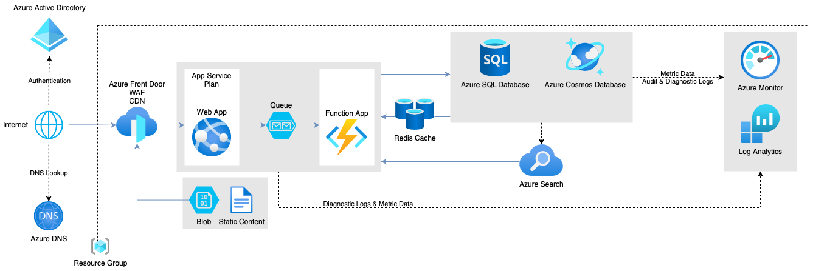
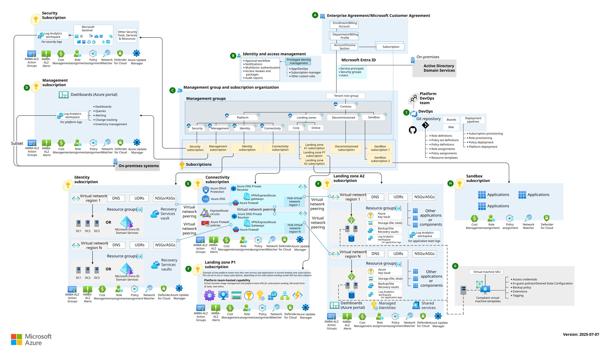
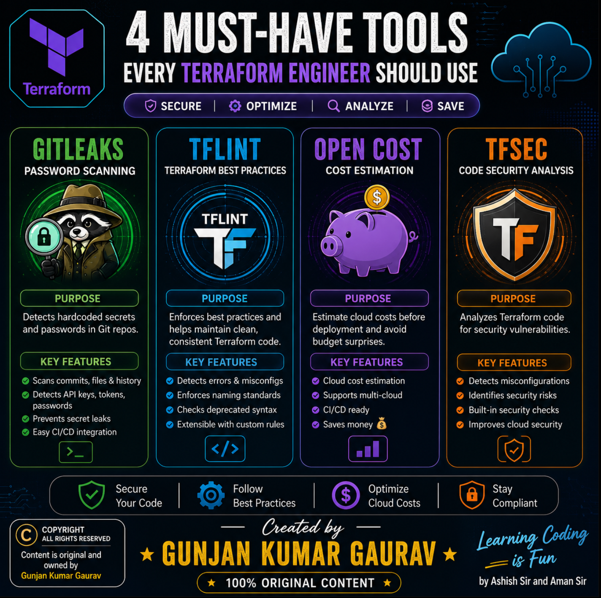
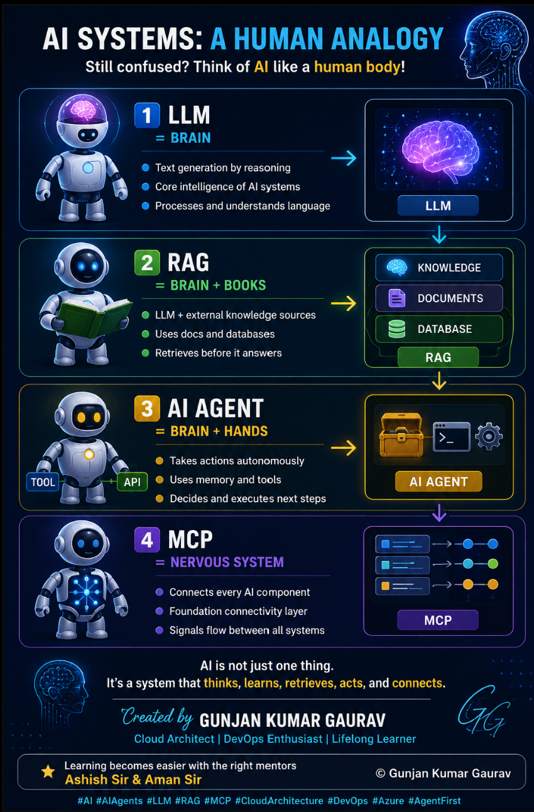

<div align="center">


<br/>

<a href="https://git.io/typing-svg">
  
</a>

<br/><br/>

[](https://www.linkedin.com/in/gunjan-gaurav)
[](https://learn.microsoft.com/en-us/users/gunjankumargaurav/)
[](https://learn.microsoft.com/en-us/users/gunjankumargaurav/)
[](https://github.com/gunjankumargaurav7350)

<br/>

[](https://www.linkedin.com/in/gunjan-gaurav)
[](mailto:gunjankumargaurav7@gmail.com)
[](https://github.com/gunjankumargaurav7350)
[](https://maps.google.com)

</div>


## `$` whoami --verbose

```yaml
identity:
  name: "Gunjan Kumar Gaurav"
  designation: "Senior Cloud & DevSecOps Consultant"
  current_organization: "Sify Digital Services Limited"
  overall_it_experience: "9+ Years (IT Operations, Infrastructure & Platform Systems)"
  specialized_cloud_exp: "5+ Years (Azure Architecture, Terraform IaC, DevSecOps & Governance)"
  education: "Bachelor of Engineering (B.E.), Information Technology — RGPV Bhopal"

credentials:
  certifications:
    - "Microsoft Certified: Azure Solutions Architect Expert (AZ-305)"
    - "Microsoft Certified: Azure Administrator Associate (AZ-104)"

core_architectural_impact:
  enterprise_migrations: "100+ Enterprise Workloads migrated from On-Premises to Azure with zero downtime"
  iac_standardization: "Modular Terraform Enterprise Landing Zones cutting environment delivery time by 50%"
  finops_optimization: "28%+ Cloud spend reduction through RI planning, auto-scaling & log telemetry hygiene"
  devsecops_hardening: "Shift-Left security pipelines with Checkov, tfsec, Trivy & SonarQube in CI/CD gates"
  ai_platform_engineering: "Integrating Model Context Protocol (MCP), Enterprise RAG & Autonomous SRE Agents"

status: "● Open to Executive Advisory, Principal Architecture & Global Cloud Leadership roles"
```


## 💡 Executive Value Proposition & Leadership Philosophy

With **9+ years of progressive enterprise IT experience** — including **5+ years specializing in Azure Cloud, Terraform, DevSecOps, and Platform Engineering** — I bridge the gap between high-level executive business strategy and production-grade engineering execution. 

I architect resilient cloud foundations that solve the four foundational challenges of modern enterprises:
1. **Speed without Compromise:** Eliminating manual provisioning through modular Terraform Landing Zones and automated Azure DevOps / GitHub Actions pipelines.
2. **Zero-Trust Security by Default:** Enforcing policy-as-code guardrails, Privileged Identity Management (PIM), customer-managed encryption, and shift-left static security scanning.
3. **Financial Discipline (FinOps):** Embedding cost observability into the pull request cycle (Infracost) and rightsizing infrastructure for maximum capital efficiency.
4. **AI-Augmented Operations:** Pioneering the transition to **Agentic DevSecOps**, utilizing **Model Context Protocol (MCP)**, **Enterprise RAG for Cloud Compliance**, and **Autonomous Self-Healing SRE Agents**.

> *"Enterprise infrastructure is not merely code; it is a legally binding contract of reliability, governance, security, and financial stewardship between engineering and business stakeholders."*

---

## ⚡ Technical Arsenal & Core Competency Matrix

<div align="center">

| Domain | Enterprise Tools & Technologies |
| :--- | :--- |
| **Cloud Platforms & Architecture** | `Microsoft Azure` `Enterprise Landing Zones (CAF)` `Management Groups` `Hub-and-Spoke` `Virtual WAN` `Azure App Services` `AKS (Kubernetes)` |
| **Infrastructure as Code (IaC)** | `Terraform (Modules / Remote State Locking)` `Bicep` `ARM Templates` `Terratest` `Cloud-Init / Custom Script Extensions` |
| **CI/CD & GitOps** | `Azure DevOps (YAML Multi-Stage)` `GitHub Actions` `OIDC Cloud Federation` `ArgoCD` `Blue-Green / Canary Deployments` `GitFlow` |
| **DevSecOps & Shift-Left** | `tfsec` `Checkov` `Trivy (Container/IaC)` `SonarQube` `TruffleHog` `GitLeaks` `Branch Protection & CODEOWNERS` |
| **Security & Identity (Zero Trust)** | `Microsoft Entra ID` `Privileged Identity Management (PIM)` `Managed Identities` `Azure Key Vault` `Defender for Cloud` `Sentinel SIEM` |
| **Networking & Defense** | `Azure Firewall Premium` `Network Security Groups (NSGs)` `Application Gateway (WAF v2)` `Private Endpoints` `Private DNS Zones` `UDRs` |
| **Observability, SRE & FinOps** | `Azure Monitor` `Log Analytics (KQL)` `Azure Monitor Agent (AMA)` `Data Collection Rules (DCR)` `Grafana` `Prometheus` `Infracost` `OpenCost` |
| **🤖 AI & Agentic Platform Engineering** | `Model Context Protocol (MCP)` `Enterprise RAG (Azure AI Search / Vector DBs)` `LangGraph / Multi-Agent Swarms` `Autonomous SRE Agents` |
| **Operating Systems & Scripting** | `PowerShell 7.x` `Bash / Linux Shell` `Red Hat Enterprise Linux (RHEL)` `Ubuntu LTS` `Windows Server 2022` |

</div>


# 🎯 Senior DevOps / Cloud Architect Masterclass & Blueprint

> **Session Context:** Core architectural pillars, enterprise governance, end-to-end migration strategy (100+ workloads), DevSecOps automation, FinOps, team leadership, vendor management, and AI-Augmented Platform Engineering.  
> **Reference Architecture:** Enterprise Multi-Subscription CAF Landing Zone & Autonomous Operations.

---

## 1. Real-World Architecture Scenario: 100+ Application Enterprise Migration

```
[ 1. Scalable ]   --> Handles Load & Elastic Compute
       |
       v
[ 2. Robust ]     --> Auto-Recovers & Fault-Tolerant Design
       |
       v
[ 3. Secure ]     --> Zero Trust Identity, PIM & Encryption
       |
       v
[ 4. Reliable ]   --> High Production SLAs (99.99% Uptime)
       |
       v
[ 5. Portable ]   --> Reusable Infrastructure as Code Modules
       |
       v
[ 6. Governed ]   --> Enterprise Azure Policy & CAF Standards
       |
       v
[ 7. High Avail ] --> Multi-Zone Redundancy (Zero Downtime)
       |
       v
[ 8. Cost-Optim ] --> FinOps Discipline & Eliminating Cloud Waste
       |
       v
[ 9. Backed Up ]  --> Automated Disaster Recovery (Strict RPO/RTO)
       |
       v
[ 10. Monitored ] --> Full-Stack Telemetry (AMA & Sentinel SIEM)
```

<p align="center">
  
</p>

### 🔍 How Traffic Flows Through This Architecture:

1. **User Request & Edge Routing:**
   - User opens the app $\rightarrow$ **Azure DNS** resolves the domain address.
   - Traffic hits **Azure Front Door (WAF + CDN)**, which filters malicious web requests and caches static content.
   - Static files (images, frontend assets) are served directly from **Azure Blob Storage** for speed.

2. **Web App & Background Processing:**
   - Dynamic user requests go directly to the **Web App** (hosted on an **App Service Plan**).
   - Any heavy background jobs are pushed to an **Azure Queue**, which triggers a serverless **Azure Function** to process them without slowing down user interactions.

3. **Caching & Database Layer:**
   - **Redis Cache** stores active user sessions and frequent queries, preventing database overload.
   - **Azure SQL Database** stores structured, relational business data.
   - **Azure Cosmos DB** handles high-speed NoSQL and globally distributed data.
   - **Azure Search** provides fast full-text search indexing across products and catalogs.

4. **Security & Central Observability:**
   - **Azure Active Directory (Entra ID)** manages user authentication and role-based access.
   - **Azure Monitor & Log Analytics** automatically collects diagnostic logs, performance metrics, and audit trails across all services inside the resource group.

### 🚀 Migration Delivery Waves:
1. **Wave 0 (Foundation):** Tenant root structure, Hub-and-Spoke networking, ExpressRoute / S2S VPN, Azure Firewall, Log Analytics.
2. **Wave 1 (Low-Risk / Internal):** Shared IT services, dev/test tiers, internal line-of-business (LOB) apps.
3. **Wave 2 (Core Business Workloads):** Production web/API tiers, staging environments, middleware.
4. **Wave 3 (Mission-Critical / High-Transactional DBs):** Customer-facing databases, active transaction systems with near-zero RPO/RTO cutover windows.

---

## 2. Enterprise Governance, Identity & Management Hierarchy

### Cloud Adoption Framework (CAF) Methodology
Microsoft CAF guides end-to-end cloud adoption across six iterative phases:
* **Strategy:** Business case validation, executive sponsorship, financial ROI criteria.
* **Plan:** Workload prioritization, organizational alignment, cloud readiness training.
* **Ready:** Landing zone provisioning, networking baseline, identity federation.
* **Adopt:** Workload migration sprints, application containerization, DB modernization.
* **Govern:** Azure Policy initiatives (CIS Benchmarks, MCSB), tag enforcement, cost guardrails.
* **Secure & Manage:** Defender for Cloud Secure Score optimization, automated patching, SIEM integration.

### Tenant & Management Group Hierarchy

```
[ Microsoft Entra ID Tenant ]
              |
              v
    [ Tenant Root Group ]
              |
              |--> [ Platform Management Group ]
              |       |-- Identity (AD/DNS)
              |       |-- Management (Logs/Mon)
              |       `-- Connectivity (Hub/Firewall)
              |
              |--> [ Landing Zones (Workloads) ]
              |       |-- Corp (Internal Only)
              |       |-- Online (Public/DMZ)
              |       `-- Dev / UAT / Prod Subscriptions
              |
              `--> [ Decommissioned / Sandbox ]
                      |-- Sandbox Subscriptions
                      `-- Decommissioned MG
```

### Governance Best Practices:
* **Subscription Boundaries:** Strictly separate subscriptions by environment (`Dev`, `UAT`, `Prod`) and function (`Platform` vs `Workload`) to eliminate noisy-neighbor issues and constrain security blast radiuses.
* **Azure Policy & Initiatives:** Enforce regulatory standards (CIS Azure Foundations, ISO 27001) at the Management Group root with automated remediation tasks for missing tags or unencrypted storage.
* **Identity Governance & PIM:** Zero permanent administrative privileges. Require Microsoft Entra Privileged Identity Management (PIM) with time-bound activations (maximum 4–8 hours), mandatory ticket justification, and multi-stage manager approvals.

---

## 3. Enterprise Hub-and-Spoke Networking Architecture

<p align="center">
  
</p>

```
[ On-Premises Datacenter ]
           |
   (ExpressRoute / S2S VPN)
           |
           v
[ Hub VNet: Central Inspection ]
   • Azure Firewall / NVA (Deep Packet Inspection)
   • GatewaySubnet (VPN / ExpressRoute Gateway)
   • Private DNS Zones (privatelink.azure.com)
           |
           |--> (VNet Peering + UDR 0.0.0.0/0 -> Firewall IP)
           |
           |--> [ Spoke 1: Workload VNet ]
           |       • App & DB Subnets
           |       • PaaS Private Endpoints
           |       • Internal Micro-Segmentation
           |
           `--> [ Spoke 2: Shared Services VNet ]
                   • CI/CD Self-Hosted Runners
                   • Azure Bastion Host
                   • Centralized Tooling
```

### Core Networking Highlights:
* **IP Address Management (IPAM) & Non-Overlapping CIDRs:** Systematic allocation preventing RFC 1918 collision between on-prem datacenters and multi-region cloud spokes.
* **Deterministic Traffic Routing:** User Defined Routes (UDRs) assigned to all spoke subnets routing `0.0.0.0/0` and inter-spoke traffic directly to Azure Firewall Private IP for deep packet inspection.
* **Isolated PaaS via Private Endpoints:** Disabling public endpoints on Azure Storage, Key Vault, and SQL instances, resolving traffic via central Hub Private DNS Zones.
* **Zero Direct Public Exposure:** Administrative access secured through Azure Bastion; inbound web traffic filtered through Azure Application Gateway with WAF v2 (OWASP ModSecurity Core Rule Set).

---

## 4. Multi-Layered Defense-in-Depth Security

<p align="center">
  
</p>

| Defense Layer | Enterprise Controls & Tooling |
| :--- | :--- |
| **1. Identity Layer** | Microsoft Entra ID, Conditional Access policies, PIM, Phishing-Resistant MFA, Managed Identities (avoiding static service principal secrets). |
| **2. Perimeter & Network** | Hub-and-Spoke, Micro-segmentation via Application Security Groups (ASGs) & NSGs, Azure Firewall Premium with TLS inspection, DDoS Protection. |
| **3. Compute & Host** | Defender for Servers, automated baseline OS vulnerability patching, Customer-Managed Key (CMK) disk encryption, run-as-non-root containers. |
| **4. Data at Rest & Transit** | Azure Key Vault HSM-backed keys, TLS 1.3 enforced, Transparent Data Encryption (TDE), automated secret rotation via Event Grid. |
| **5. Application & CI/CD** | Static Application Security Testing (SAST), Software Composition Analysis (SCA), TruffleHog secret scanning, Checkov IaC security gates. |

---

## 5. Terraform Landing Zone Automation & Best Practices

```
[ Terraform Git Repository (Trunk-based) ] 
                     |
                     v
[ Step 1: Format & Linting (terraform fmt -check && tflint) ]
                     |
                     v
[ Step 2: Static Security Scanning (Checkov + tfsec + Trivy) ]
                     |
                     v
[ Step 3: Cost Prediction & Budget Gate (Infracost) ]
                     |
                     v
[ Step 4: Terraform Plan & Dynamic Artifact Generation ]
                     |
                     v
[ Step 5: Manual Approval Gate (Senior Architect Sign-off) ]
                     |
                     v
[ Step 6: Terraform Apply (Locked Remote State via Azure Blob Storage) ]
```

* **Remote State Governance:** State files encrypted with Customer-Managed Keys (CMK) in geo-redundant storage accounts, protected by Blob Lease Locking and strict RBAC.
* **Modular Engineering:** Highly reusable, strictly versioned child modules for VNets, Subnets, NSGs, Storage Accounts, and AKS clusters.
* **Automated Drift Detection:** Nightly scheduled CI/CD pipelines executing `terraform plan -detailed-exitcode` to instantly alert on console modifications.
* **Infrastructure Testing:** Automated unit and regression testing powered by `Terratest` in Golang before module release.

---

## 6. Azure Repos & DevSecOps Pipelines

* **Branching Model:** Trunk-based development with short-lived feature branches (`feat/*`, `fix/*`, `infra/*`).
* **Branch Policy Enforcement:**
  * Mandatory Pull Request (PR) with minimum 2 senior peer reviewers.
  * Integration with `CODEOWNERS` for automated security team review on IAM/Network modules.
  * Required passing builds: All linters, security scanners, and Terraform validation must pass prior to merge.
  * Direct push and branch deletion strictly blocked on `main`.
* **Multi-Stage YAML Pipeline Standard:**
  1. **Phase 1 (Validate):** Syntax check, formatting verification, tflint execution.
  2. **Phase 2 (Security):** GitLeaks secret scan, Trivy filesystem check, Checkov compliance.
  3. **Phase 3 (Cost Gate):** Infracost delta comparison posted directly to PR comments.
  4. **Phase 4 (Plan):** Speculative plan generation stored as pipeline build artifact.
  5. **Phase 5 (Approval):** Change Advisory Board (CAB) / Senior Architect gated sign-off.
  6. **Phase 6 (Apply):** Zero-downtime execution with automated rollback mechanisms.

---

## 7. End-to-End Cloud Migration Strategy

```
[ 1. Discovery ]  -->  [ 2. Assessment ]  -->  [ 3. Readiness ]  -->  [ 4. Cutover ]  -->  [ 5. Hypercare ]
       |                       |                       |                      |                     |
       v                       v                       v                      v                     v
  Inventory &             Compatibility           Landing Zone            Downtime &            24x7 War Room
  Dependencies              & TCO ROI                 Ready               Cutover Window           Support
```

### Comprehensive Migration Lifecycle:
* **Pre-Migration (Discovery & TCO):** Running Azure Migrate discovery appliances, mapping application-to-database dependency maps, verifying network throughput sizing, and calculating 3-year TCO.
* **Readiness & Staging:** Verifying Landing Zone readiness, setting up database continuous replication (Azure Database Migration Service / Data Guard), pre-seeding virtual machine disks.
* **Cutover Window:** Reducing DNS TTL to 300 seconds, executing final database synchronization, updating connection strings, rerouting traffic, and performing automated sanity validation.
* **Post-Migration & Hypercare:** Establishing a 24x7 war room for 14–30 days, analyzing performance telemetry, fine-tuning capacity thresholds, and documenting the official post-migration handover.

---

## 8. FinOps (Cloud Financial Management)

* **Waste Elimination:** Automated serverless functions detecting and purging unattached managed disks, orphaned public IPs, and legacy storage snapshots.
* **Utilization Rightsizing:** Analyzing 30-day P95 CPU and memory metrics to downscale over-provisioned compute instances.
* **Commitment Architecture:** Leveraging 1-year and 3-year Azure Savings Plans and Reserved Instances (RIs) for baseline predictable compute tiers (delivering up to 60–72% savings).
* **Non-Production Automation:** Scheduled shutdown of Dev and UAT VMs and AKS node pools outside working hours (saving up to 65% of environment runtime cost).
* **Telemetry Cost Hygiene:** Ingestion filtering using Azure Monitor Data Collection Rules (DCR) to drop verbose debug logs prior to workspace storage.

---

## 9. Backup, Disaster Recovery & High Availability

* **Storage Redundancy Hierarchy:**
  * **LRS (Locally Redundant Storage):** 3 synchronous copies within a single datacenter facility.
  * **ZRS (Zone-Redundant Storage):** 3 copies distributed across three distinct availability zones in a single region.
  * **GRS / GZRS (Geo-Redundant):** Asynchronous replication to a secondary paired geographic region for catastrophic disaster recovery.
* **High Availability Compute:** Multi-Zone Virtual Machine Scale Sets (VMSS) and AKS clusters distributed across Availability Zones with zone-redundant load balancers.
* **RTO & RPO Engineering:**
  * **RTO (Recovery Time Objective):** Maximum acceptable duration of downtime before system recovery.
  * **RPO (Recovery Point Objective):** Maximum acceptable transactional data loss measured in elapsed time.
* **Disaster Recovery Automation:** Azure Site Recovery (ASR) orchestration with automated failover testing scripts and cross-region DNS failover via Azure Traffic Manager / Front Door.

---

## 10. Enterprise Observability & Monitoring

* **Centralized Telemetry Pipeline:** Aggregation of OS metrics, application telemetry, network flow logs, and audit trails into centralized Log Analytics Workspaces.
* **Azure Monitor Agent (AMA) & DCRs:** Replacing legacy MMA with AMA, using granular Data Collection Rules for selective log ingestion at source.
* **Multi-Tier Dashboarding:** Executive operational health dashboards in Grafana; real-time application tracing using OpenTelemetry and Application Insights.
* **Smart Alerting & Pager Escalations:** Dynamic threshold alerts routing to Microsoft Teams, Slack, and PagerDuty with predefined escalation runbooks.

---

## 11. Vendor Management & Delivery Governance

Architects regularly evaluate, negotiate with, and govern external partners and vendors.

```
[ RFI (Request for Information) ]
               |
[ RFP (Request for Proposal) ]
               |
[ Technical Evaluation Matrix (Architecture, Security, Cost) ]
               |
[ SOW (Statement of Work) & Commercials ]
               |
[ Project Sprints & Deliverable Milestones ]
               |
[ Acceptance Criteria Sign-Off & Payment Release ]
```

### Critical Governance Principles:
* **SOW (Statement of Work):** Legally binding definition of scope, non-functional requirements (NFRs), milestone criteria, and liability limits.
* **Technical Evaluation Matrix:** Objective scoring of vendors based on architectural maturity, security compliance, past reference cases, and total cost of ownership.
* **RACI Matrix:**
  * **R**esponsible: Engineer executing the build.
  * **A**ccountable: Architect owning the ultimate delivery outcome.
  * **C**onsulted: Security, compliance, and network subject matter experts.
  * **I**nformed: Business and executive stakeholders.
* **Formal Transition:** Detailed runbook handover, operational shadowing, architecture walk-throughs, and disaster recovery simulation prior to commercial milestone sign-off.

---


# 🤖 12. AI-Augmented DevSecOps & Platform Engineering (MCP, RAG & Autonomous Agents)

> The modern cloud paradigm is undergoing a generational shift: moving from purely static automation toward **Agentic Platform Engineering**. I integrate **Large Language Models (LLMs)**, **Small Language Models (SLMs)**, **Model Context Protocol (MCP)**, and **Autonomous Multi-Agent Swarms** directly into the DevSecOps lifecycle.

<p align="center">
  
</p>

```
[ Model Context Protocol (MCP) ]         [ Enterprise RAG Knowledge Base ]
• Azure Resource Graph MCP               • CIS & ISO Compliance Vectors
• Terraform State Query MCP              • Enterprise ADR Knowledge Base
• K8s Cluster Telemetry MCP              • Cloud Architecture SOPs
                 \                      /
                  \                    /
                   v                  v
             [ Autonomous Multi-Agent Swarm ]
                            |
                            |--> [ 1. IaC Auto-Fixer ]   : Scans Checkov & auto-generates HCL fixes
                            |--> [ 2. Drift Sentinel ]   : Catches portal changes & alerts or self-heals
                            |--> [ 3. SRE Root-Cause ]   : Correlates telemetry & writes RCA in minutes
                            `--> [ 4. FinOps Optimizer ] : Detects orphaned disks & auto-rightsizes
```

### 12.1 Model Context Protocol (MCP) in Cloud Operations
* **What is MCP?** An open standard for connecting AI systems with external data sources and execution tools in a secure, standardized manner.
* **Enterprise Cloud Applications:**
  * **Azure Resource Graph MCP Server:** Enables LLMs to execute natural-language queries across multi-subscription estates (*"List all storage accounts with public network access enabled in production"*).
  * **Terraform State & Schema MCP:** Allows intelligent agents to inspect current state locks, verify resource dependencies, and formulate plan validations without exposing raw credentials.
  * **Kubernetes SRE MCP:** Connects directly with AKS APIs to retrieve pod logs, crash loop backoffs, and Helm releases for instant diagnostic analysis.

### 12.2 Enterprise RAG for Cloud Compliance & Architectural Decision Records (ADRs)
* **Architecture:** Enterprise documentation, past Architectural Decision Records (ADRs), Microsoft CAF reference guides, and company security policies are chunked, embedded, and stored in **Azure AI Search / Vector DBs**.
* **Pre-Flight PR Verification:** When a pull request is submitted, a specialized RAG agent evaluates the proposed Terraform code against company compliance benchmarks and architectural standards:
  * Verifies whether subnets match internal CIDR IPAM standards.
  * Validates whether mandatory tagging taxonomies (`Environment`, `CostCenter`, `Owner`) are enforced.
  * Cites exact company compliance bylaws when flagging violations.

### 12.3 The Autonomous DevSecOps Multi-Agent Swarm
1. **IaC Security & Auto-Remediation Agent:**
   * Ingests static security findings from `Checkov` and `Trivy`.
   * Automatically formulates the exact remediated HCL code block.
   * Creates a dedicated Git commit with an explanation of the security risk and the applied patch.
2. **Cloud Drift Sentinel Agent:**
   * Correlates Azure Monitor Activity Logs with Terraform state files.
   * If an engineer manually alters an NSG rule or firewall route in the Azure Portal, the agent detects the out-of-band change, flags the deviation, and drafts a remediation pull request.
3. **Autonomous SRE & Post-Mortem Incident Agent:**
   * Upon receipt of a high-severity Azure Monitor alert, the agent gathers diagnostic logs, correlates distributed traces across Hub-and-Spoke networks, queries the incident knowledge base, and outputs an initial Root Cause Analysis (RCA) with proposed corrective runbooks within minutes.
4. **FinOps Autonomous Rightsizing Agent:**
   * Analyzes 30-day resource utilization curves, cross-references with Infracost pricing models, and generates automated pull requests to downscale idle instances or trigger automated reservation purchases.

---


# 🚀 13. Featured Production Repositories & Enterprise Frameworks

<table width="100%">
<tr>

<td width="50%" valign="top">

### 🏗️ [Azure Landing Zone Terraform](https://github.com/gunjankumargaurav7350/Azure-Landing-Zone-Terraform)

Enterprise-scale CAF-compliant Landing Zone built with modular, production-tested Terraform.

<b>Key Architectural Components:</b><br>
• Enterprise Management Group Hierarchy<br>
• Hub-and-Spoke VNet Peering with Azure Firewall<br>
• Centralized Private DNS & Private Endpoints<br>
• Azure Policy Guardrails & RBAC Governance<br>
• Remote State Locking via Azure Blob Storage<br><br>

<a href="https://github.com/gunjankumargaurav7350/Azure-Landing-Zone-Terraform"><b>🔗 Explore Repository & Modules →</b></a>

</td>

<td width="50%" valign="top">

### 🛡️ Enterprise DevSecOps Hardened CI/CD

Multi-stage shift-left delivery pipelines for Azure DevOps and GitHub Actions.

<b>Security Gates & Tools:</b><br>
• Secret scanning with TruffleHog & GitLeaks<br>
• Static IaC vulnerability checks via Checkov & tfsec<br>
• Container image scanning with Trivy<br>
• Code quality gates with SonarQube<br>
• Automated cost impact analysis with Infracost<br><br>

<a href="https://github.com/gunjankumargaurav7350"><b>🔗 View Pipeline Templates →</b></a>

</td>

</tr>
<tr>

<td width="50%" valign="top">

### 🤖 AI-Driven Cloud SRE & MCP Toolkit

Reference implementations connecting Model Context Protocol (MCP) servers to Azure Cloud Operations.

<b>Capabilities:</b><br>
• Azure Resource Graph Natural Language MCP<br>
• Terraform State Inspection Tools for LLMs<br>
• Automated Drift Detection & Incident Analysis<br>
• RAG engine for Cloud Architectural Decision Records<br><br>

<a href="https://github.com/gunjankumargaurav7350"><b>🔗 View AI & MCP Projects →</b></a>

</td>

<td width="50%" valign="top">

### 🔐 Zero-Trust Identity & Governance Engine

Production governance framework for Microsoft Entra ID and Azure Subscriptions.

<b>Key Capabilities:</b><br>
• Entra ID Privileged Identity Management (PIM)<br>
• Managed Identity automation across workloads<br>
• Key Vault HSM integration and secret rotation<br>
• Defender for Cloud continuous compliance auditing<br><br>

<a href="https://github.com/gunjankumargaurav7350"><b>🔗 View Governance Patterns →</b></a>

</td>

</tr>
</table>

---


## 📊 GitHub Analytics & Engineering Velocity

<div align="center">


<br/><br/>


</div>


## 🤝 Let's Connect & Build Resilient Cloud Systems

Whether you are seeking a **Senior Cloud Architect**, a **DevSecOps Consultant**, or strategic guidance on **Enterprise Azure Migrations, FinOps, and AI-Augmented Platform Engineering**, I welcome impactful conversations:

<div align="center">

[](https://www.linkedin.com/in/gunjan-gaurav)
[](mailto:gunjankumargaurav7@gmail.com)
[](https://github.com/gunjankumargaurav7350)

<br/><br/>

### 💭 Daily Inspiration & Engineering Wisdom


<br/><br/>


<sub>⭐ If this architecture blueprint or profile adds value to your engineering journey, feel free to star this repository and share it across your network!</sub>

</div>
