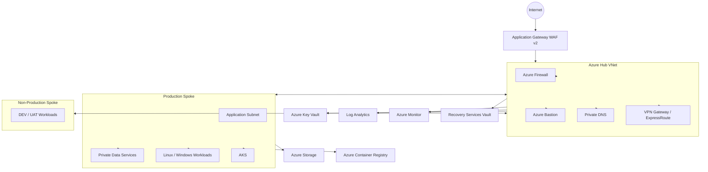

# 🚀 Enterprise Azure Landing Zone — Terraform & DevSecOps


> **Enterprise-oriented Azure Landing Zone implemented with Terraform, modular IaC, Hub-and-Spoke networking, centralized security, private connectivity, observability, backup/DR, FinOps and Azure DevOps DevSecOps automation.**

---

## 📌 Table of Contents

- [1. Executive Overview](#1--executive-overview)
- [2. Architecture Principles](#2--architecture-principles)
- [3. Enterprise Azure Landing Zone](#3--enterprise-azure-landing-zone)
- [4. High-Level Architecture](#4--high-level-architecture)
- [5. Hub-and-Spoke Networking](#5--hub-and-spoke-networking)
- [6. Network Security and Traffic Flow](#6--network-security-and-traffic-flow)
- [7. Identity and Access Management](#7--identity-and-access-management)
- [8. Governance and Azure Policy](#8--governance-and-azure-policy)
- [9. Terraform Enterprise Architecture](#9--terraform-enterprise-architecture)
- [10. Terraform State Management](#10--terraform-state-management)
- [11. Repository Structure](#11--repository-structure)
- [12. Environment Strategy](#12--environment-strategy)
- [13. Azure Services](#13--azure-services)
- [14. Private Connectivity](#14--private-connectivity)
- [15. Compute and Application Delivery](#15--compute-and-application-delivery)
- [16. Monitoring and Observability](#16--monitoring-and-observability)
- [17. Backup, HA and Disaster Recovery](#17--backup-ha-and-disaster-recovery)
- [18. DevSecOps Toolchain](#18--devsecops-toolchain)
- [19. Azure DevOps CI/CD](#19--azure-devops-cicd)
- [20. Branching Strategy](#20--branching-strategy)
- [21. FinOps and Cost Optimization](#21--finops-and-cost-optimization)
- [22. Enterprise Migration](#22--enterprise-migration)
- [23. Middleware and Bootstrap](#23--middleware-and-bootstrap)
- [24. Vendor, RFP/RFI and Governance](#24--vendor-rfprfi-and-governance)
- [25. Transition, KT and RACI](#25--transition-kt-and-raci)
- [26. Human-Gated Agentic AI](#26--human-gated-agentic-ai)
- [27. Deployment](#27--deployment)
- [28. Security and Secrets](#28--security-and-secrets)
- [29. Troubleshooting](#29--troubleshooting)
- [30. Production Readiness Checklist](#30--production-readiness-checklist)
- [31. Command Reference](#31--command-reference)
- [32. Project Highlights](#32--project-highlights)
- [33. Principal-Level Takeaways](#33--principal-level-takeaways)
- [34. Author](#34--author)

---

# 1. 🎯 Executive Overview

This repository demonstrates an enterprise-style **Azure Landing Zone** built with **Terraform** and designed for repeatable, governed and secure cloud adoption.

The solution separates:

- Platform foundations
- Network connectivity
- Identity
- Security
- Workload environments
- Monitoring
- Backup and recovery
- Cost management
- CI/CD automation

The architecture is intentionally modular so the same Terraform modules can be reused across **DEV, UAT and PROD** without duplicating infrastructure code.

### Core objectives

- Modular Infrastructure as Code
- Reusable Terraform modules
- Environment isolation
- AzureRM remote state
- State locking
- Hub-and-Spoke networking
- Centralized ingress and egress
- Least-privilege access
- Private connectivity
- Security scanning before deployment
- Automated cost estimation
- Terraform plan review
- Human-controlled production deployment
- Observability and operational ownership
- Backup and tested recovery
- Enterprise governance

---

# 2. 🧭 Architecture Principles

The platform follows these engineering principles:

| Principle | Implementation |
|---|---|
| Least privilege | Entra ID, RBAC, PIM, Managed Identity |
| Zero Trust | Private access, identity-based authorization, segmentation |
| Defense in depth | WAF + Firewall + NSG + Policy + Defender |
| Immutable/repeatable infrastructure | Terraform |
| Environment isolation | Separate environment roots/state |
| Centralized governance | Management Groups + Azure Policy |
| Private-by-default | Private Endpoints + Private DNS |
| Secure administration | Azure Bastion |
| Observability | Azure Monitor + Log Analytics |
| Cost awareness | Budgets + Infracost + FinOps |
| Controlled production changes | PR + Plan + Approval |
| Operational resilience | Backup + HA + DR runbooks |
| Automation | Azure DevOps / GitHub Actions |

---

# 3. 🏢 Enterprise Azure Landing Zone

A Landing Zone is more than a collection of VNets. It is a **governed cloud foundation**.

```text
Azure Tenant
│
├── Management Groups
│   ├── Platform
│   │   ├── Connectivity
│   │   ├── Identity
│   │   ├── Management
│   │   └── Security
│   │
│   ├── Landing Zones
│   │   ├── Production
│   │   └── NonProduction
│   │
│   ├── Sandbox
│   └── Decommissioned
│
└── Subscriptions
    ├── Connectivity
    ├── Identity
    ├── Management
    ├── Security
    ├── Production
    └── NonProduction
```

### Management Groups

Management Groups provide governance inheritance for:

- Azure Policy
- RBAC
- Compliance
- Standards
- Subscription organization

### Subscription boundaries

Subscriptions provide:

- Billing boundaries
- Quota boundaries
- Administrative isolation
- Workload separation
- Lifecycle management
- Delegated ownership

---

# 4. 🏗️ High-Level Architecture



### Design intent

- Internet-facing traffic enters through WAF.
- Hub provides centralized connectivity and security services.
- Spokes contain workload-specific resources.
- Azure Firewall controls inspected traffic.
- Bastion provides administrative access without VM public IPs.
- Private DNS supports private endpoint name resolution.
- Monitoring and logging are centralized.
- Backup is designed as a platform capability rather than an application afterthought.

---

# 5. 🌐 Hub-and-Spoke Networking

The Hub-and-Spoke model centralizes shared network services while isolating workloads.

```text
                         Internet
                            │
                            ▼
                 Application Gateway
                       WAF v2
                            │
                            ▼
                     ┌───────────┐
                     │ HUB VNET  │
                     └───────────┘
                      │    │    │
          ┌───────────┘    │    └────────────┐
          ▼                ▼                 ▼
      Firewall          Bastion       VPN / ExpressRoute
          │
          ▼
     Controlled Egress
          │
          ├───────────────► Production Spoke
          │                   ├── App
          │                   └── Data
          │
          └───────────────► NonProd Spoke
                              ├── DEV
                              └── UAT
```

## IPAM and CIDR strategy

Before allocating CIDRs:

1. Inventory on-premises networks.
2. Inventory existing Azure networks.
3. Inventory partner connectivity.
4. Reserve future growth ranges.
5. Avoid overlapping CIDRs.
6. Document subnet purpose.
7. Separate application, data, management and private endpoint ranges.

Example:

```text
10.0.0.0/16      Hub
10.10.0.0/16     Production
10.20.0.0/16     UAT
10.30.0.0/16     DEV
```

> CIDR ranges are examples only. Production allocation must follow the organization's IPAM strategy.

---

# 6. 🔥 Network Security and Traffic Flow

### Ingress

```text
Internet
   │
   ▼
Application Gateway
   │
   ├── WAF inspection
   ├── TLS termination
   ├── Routing
   └── Health probes
   │
   ▼
Application / Workload
```

### Egress

```text
Private Workload
      │
      ▼
UDR / Route Table
      │
      ▼
Azure Firewall
      │
      ▼
Internet / External Service
```

### East-West traffic

East-West traffic between workloads should be explicitly designed and controlled.

Controls can include:

- NSGs
- UDRs
- Azure Firewall
- Private Endpoints
- Application-level authorization
- Network segmentation

### Important design consideration

A route table alone does not provide security. Routing determines **where traffic goes**; firewall/NSG/policy controls determine **whether traffic is allowed**.

---

# 7. 🔐 Identity and Access Management

Identity is the primary security control plane.

## Microsoft Entra ID

Recommended patterns:

- Use groups instead of direct user assignments.
- Use PIM for privileged roles.
- Enforce MFA and Conditional Access.
- Use managed identities for Azure workloads.
- Prefer Workload Identity Federation for CI/CD.
- Avoid long-lived client secrets.

## RBAC hierarchy

```text
Management Group
      │
      ▼
Subscription
      │
      ▼
Resource Group
      │
      ▼
Resource
```

Use the highest practical scope that satisfies the business requirement, but avoid broad permissions when a narrower scope is sufficient.

## Managed Identity

Instead of:

```text
Application
   │
   └── username/password/secret
```

Prefer:

```text
Application
   │
   ▼
Managed Identity
   │
   ▼
Azure RBAC
   │
   ▼
Azure Resource
```

---

# 8. 🛡️ Governance and Azure Policy

Azure Policy provides preventive and detective governance.

### Policy effects

| Effect | Purpose |
|---|---|
| Deny | Block prohibited configuration |
| Audit | Detect non-compliance |
| DeployIfNotExists | Deploy required configuration |
| Modify | Standardize supported properties |
| AuditIfNotExists | Detect missing dependent configuration |
| Initiative | Group policies into a governance objective |

### Governance model

```text
Management Group
      │
      ▼
Policy / Initiative
      │
      ▼
Subscription
      │
      ▼
Resource Group
      │
      ▼
Resource
```

### Policy exceptions

A policy exemption should not simply be a permanent bypass.

Document:

- Owner
- Business justification
- Scope
- Compensating control
- Expiry date
- Approval

---

# 9. 🧩 Terraform Enterprise Architecture

The project follows:

```text
Environment Root
      │
      ▼
Parent Configuration
      │
      ├── Resource Group
      ├── VNet
      ├── Subnet
      ├── NSG
      ├── Route Table
      ├── NAT Gateway
      ├── Firewall
      ├── NIC
      ├── VM
      ├── Bastion
      ├── Application Gateway
      ├── AKS
      ├── ACR
      ├── Key Vault
      ├── Private Endpoint
      ├── Private DNS
      ├── Monitoring
      └── Backup
               │
               ▼
        Azure Infrastructure
```

Each reusable module should normally contain:

```text
module-name/
├── main.tf
├── variables.tf
└── outputs.tf
```

### Module engineering principles

- Strongly typed variables
- Meaningful outputs
- Minimal duplication
- Stable resource addressing
- `for_each` where stable keys are useful
- Explicit dependencies only when implicit dependencies are insufficient
- Versioned modules
- Consistent naming
- Standard tags
- Environment-aware configuration

---

# 10. 💾 Terraform State Management

Terraform state is sensitive infrastructure metadata.

Recommended architecture:

```text
Terraform
   │
   ▼
Azure Storage Account
   │
   └── Blob Container
          │
          └── Environment State
```

Example:

```text
tfstate/
├── dev.tfstate
├── uat.tfstate
└── prod.tfstate
```

### State requirements

- Remote backend
- Blob-based state
- State locking
- Restricted RBAC
- Network controls where appropriate
- Backup/protection
- Controlled administrative access

### State operations

```powershell
terraform state list

terraform state show <address>

terraform import <address> <resource-id>

terraform state mv <source> <destination>

terraform state rm <address>
```

`terraform state rm` removes Terraform management of a resource; it does **not** delete the Azure resource. Use state mutation commands carefully.

---

# 11. 📁 Repository Structure

```text
azure-enterprise-landing-zone/
│
├── environments/
│   ├── dev/
│   │   ├── backend.tf
│   │   ├── backend.hcl
│   │   ├── provider.tf
│   │   ├── versions.tf
│   │   ├── variables.tf
│   │   ├── locals.tf
│   │   ├── main.tf
│   │   ├── outputs.tf
│   │   └── dev.tfvars
│   │
│   ├── uat/
│   │   └── ...
│   │
│   └── prod/
│       └── ...
│
├── modules/
│   ├── resource-group/
│   ├── virtual-network/
│   ├── subnet/
│   ├── vnet-peering/
│   ├── network-security-group/
│   ├── nsg-association/
│   ├── route-table/
│   ├── route-table-association/
│   ├── nat-gateway/
│   ├── nat-gateway-association/
│   ├── azure-firewall/
│   ├── firewall-policy/
│   ├── public-ip/
│   ├── network-interface/
│   ├── linux-vm/
│   ├── windows-vm/
│   ├── bastion/
│   ├── application-gateway/
│   ├── load-balancer/
│   ├── aks/
│   ├── acr/
│   ├── storage-account/
│   ├── storage-container/
│   ├── key-vault/
│   ├── managed-identity/
│   ├── role-assignment/
│   ├── private-endpoint/
│   ├── private-dns/
│   ├── log-analytics/
│   ├── monitor/
│   ├── action-group/
│   ├── diagnostic-settings/
│   ├── recovery-services-vault/
│   ├── backup-policy/
│   └── vm-backup/
│
├── pipelines/
│   ├── azure-pipelines-ci.yml
│   ├── azure-pipelines-cd.yml
│   └── templates/
│       ├── terraform-init.yml
│       ├── terraform-format.yml
│       ├── terraform-validate.yml
│       ├── terraform-security.yml
│       ├── gitleaks.yml
│       ├── infracost.yml
│       ├── terraform-plan.yml
│       └── terraform-apply.yml
│
├── scripts/
│   ├── register-providers.ps1
│   └── bootstrap.ps1
│
├── .gitignore
├── README.md
└── .gitleaks.toml
```

---

# 12. 🌎 Environment Strategy

The same modules should be reusable across:

```text
DEV
 │
 ├── Cost optimized
 ├── Smaller compute
 └── Lower retention

UAT
 │
 ├── Production-like validation
 ├── Moderate sizing
 └── Integration testing

PROD
 │
 ├── High availability
 ├── Strong monitoring
 ├── Strong backup retention
 ├── Production security
 └── Controlled changes
```

Each environment should have independent:

- Backend/state key
- Variables
- tfvars
- Naming
- Tags
- Network CIDRs
- VM sizing
- Policy requirements
- Configuration

Do not duplicate hundreds of lines of Terraform simply to represent environments.

---

# 13. ☁️ Azure Services

## Networking

- Azure VNet
- Subnet
- NSG
- Route Table
- NAT Gateway
- Azure Firewall
- Firewall Policy
- Application Gateway WAF v2
- Azure Bastion
- VPN Gateway
- ExpressRoute
- Private Endpoint
- Private DNS

## Compute

- Linux VM
- Windows VM
- VM Scale Sets
- AKS

## Platform

- Azure Container Registry
- Storage Account
- Key Vault

## Identity

- Microsoft Entra ID
- RBAC
- PIM
- Managed Identity

## Monitoring

- Azure Monitor
- Log Analytics
- Diagnostic Settings
- Action Groups

## Backup

- Recovery Services Vault
- Backup Policy
- VM Backup

---

# 14. 🔗 Private Connectivity

Private Endpoint provides private connectivity to supported Azure PaaS services.

```text
VM / AKS
   │
   ▼
Private DNS
   │
   ▼
Private Endpoint
   │
   ▼
Azure PaaS Service
```

Typical targets:

- Storage
- Key Vault
- Azure Container Registry
- Azure Database services
- Other supported PaaS services

### Private DNS

Private Endpoint without correct DNS integration can result in name resolution problems.

Validate:

- Private DNS zone
- VNet link
- DNS resolution
- Private endpoint NIC
- Correct service FQDN
- Routing

---

# 15. 🖥️ Compute and Application Delivery

## Linux / Windows VM

Preferred enterprise pattern:

```text
Application Gateway
       │
       ▼
Private Workload
       │
       ▼
NIC
       │
       ▼
VM Subnet
```

Avoid unnecessary public IP exposure.

Administrative access should preferably use:

```text
Administrator
      │
      ▼
Azure Bastion
      │
      ▼
Private VM
```

## Application Gateway

Application Gateway provides Layer-7 capabilities including:

- HTTP/HTTPS routing
- Host-based routing
- Path-based routing
- TLS termination
- Health probes
- WAF integration

## Load Balancer

Use Azure Load Balancer when Layer-4 TCP/UDP load balancing is the appropriate requirement.

```text
Application Gateway → Layer 7
Load Balancer       → Layer 4
```

## AKS

AKS can provide the container orchestration platform for enterprise workloads.

Typical supporting services:

```text
Developer
   │
   ▼
Container Image
   │
   ▼
Azure Container Registry
   │
   ▼
AKS
   │
   ├── Managed Identity
   ├── Private Networking
   ├── Monitoring
   └── Policy/Security
```

---

# 16. 📊 Monitoring and Observability

Observability should cover:

- Platform
- Network
- Compute
- Application
- Security
- Cost

```text
Azure Resources
      │
      ▼
Diagnostic Settings
      │
      ▼
Log Analytics
      │
      ▼
Azure Monitor
      │
      ▼
Alert / Action Group
      │
      ▼
Notification / Automation
```

## Monitoring layers

| Layer | Signals |
|---|---|
| Platform | Policy compliance, resource changes, service health |
| Network | Latency, denies, connection failures, gateway health |
| Compute | CPU, memory, disk, process/service health |
| Application | Availability, latency, error rate |
| Security | Defender alerts, privileged changes, anomalies |
| Cost | Budget burn, forecast, anomalies |

### KQL

Log Analytics can be used for centralized investigation using Kusto Query Language (KQL).

---

# 17. 💾 Backup, HA and Disaster Recovery

## RTO and RPO

**RTO — Recovery Time Objective**

Maximum acceptable time to restore service.

**RPO — Recovery Point Objective**

Maximum acceptable amount of data loss measured in time.

Example:

```text
RTO = 2 hours
RPO = 15 minutes
```

These are business requirements, not merely technical settings.

## Resiliency concepts

- Availability Zones
- Multi-region architecture
- LRS
- ZRS
- GRS
- VM Scale Sets
- Application-level redundancy
- Data replication
- Backup

### DR runbook

```text
1. Declare incident
2. Activate RACI
3. Confirm blast radius
4. Control conflicting writes
5. Validate secondary environment
6. Recover identity/network/data/application
7. Switch traffic
8. Validate health
9. Perform business validation
10. Record achieved RTO/RPO
```

> A backup that has never been restored is an assumption, not proven recovery capability.

---

# 18. 🛡️ DevSecOps Toolchain

| Tool | Enterprise Purpose |
|---|---|
| Terraform | Infrastructure as Code |
| TFLint | Terraform/provider linting |
| Checkov | IaC security/compliance |
| tfsec | Terraform security scanning |
| GitLeaks | Secret detection |
| TruffleHog | Secret discovery |
| Terratest | Infrastructure integration testing |
| Trivy | Container/filesystem vulnerability scanning |
| SonarQube | Static analysis/code quality |
| Infracost | Pre-deployment cost estimation |
| OpenCost | Kubernetes/cloud-native cost visibility |

### Security principle

Do not disable security controls just to make the pipeline green.

For a Checkov finding:

```text
Finding
   │
   ├── Real security gap → Fix
   │
   ├── False positive → Validate/document
   │
   └── Approved exception
           │
           ├── Business justification
           ├── Compensating control
           ├── Owner
           └── Expiry
```

---

# 19. 🚦 Azure DevOps CI/CD

Recommended flow:

```text
Developer
    │
    ▼
feature/*
    │
    ▼
Pull Request
    │
    ▼
CI
    │
    ├── Terraform fmt
    ├── Terraform validate
    ├── TFLint
    ├── Checkov / tfsec
    ├── GitLeaks / TruffleHog
    ├── Infracost
    └── Terraform plan
    │
    ▼
DEV
    │
    ▼
UAT Approval / Checks
    │
    ▼
UAT
    │
    ▼
PROD Approval / Checks
    │
    ▼
PROD Apply
```

### Recommended reusable templates

```text
terraform-init.yml
terraform-format.yml
terraform-validate.yml
terraform-security.yml
gitleaks.yml
infracost.yml
terraform-plan.yml
terraform-apply.yml
```

Avoid creating one unmaintainable monolithic pipeline.

### Production controls

- PR required
- Minimum reviewers
- Build validation
- Security gates
- Plan review
- Environment approvals
- Restricted direct pushes
- Protected branches
- CODEOWNERS where appropriate

---

# 20. 🌿 Branching Strategy

```text
feature/*
    │
    │ Pull Request
    ▼
trunk
    │
    ├── fmt
    ├── validate
    ├── TFLint
    ├── Security
    ├── Secret Scan
    ├── Infracost
    └── Plan
    │
    ▼
DEV / UAT
    │
    │ Pull Request
    ▼
main
    │
    ▼
Production Plan
    │
    ▼
Environment Approval
    │
    ▼
Production Apply
```

Recommended policies:

- No direct production pushes
- PR required
- Minimum reviewers
- Build validation
- Comment resolution
- Security validation
- Branch protection

---

# 21. 💰 FinOps and Cost Optimization

Cost must be treated as an architecture concern.

## Cost optimization areas

- Idle VMs
- Oversized compute
- Unattached disks
- Unused public IPs
- Excessive Log Analytics ingestion
- Long log retention
- Premium tiers without justification
- Poor reservation/savings-plan utilization
- Over-retained backups
- Non-production resources running 24x7

### FinOps lifecycle

```text
Measure
   ↓
Allocate
   ↓
Analyze
   ↓
Optimize
   ↓
Govern
   ↓
Repeat
```

### Terraform PR cost estimation

```text
Code Change
    │
    ▼
Terraform Plan
    │
    ▼
Infracost
    │
    ├── Monthly cost
    ├── Cost delta
    └── Resource breakdown
    │
    ▼
Architecture / PR Review
```

Store API keys in secure Azure DevOps variables/variable groups, not source control.

---

# 22. 🏗️ Enterprise Migration

For a 100+ application migration, start with discovery rather than immediately provisioning resources.

## Discovery

Collect:

- Application owner
- Business criticality
- Users
- Dependencies
- Data classification
- Servers
- Databases
- Storage
- DNS
- Certificates
- Firewall rules
- APIs
- SMTP
- File shares
- Vendors
- OS/runtime compatibility
- Licensing
- IP ranges
- Latency
- Bandwidth
- CPU
- Memory
- IOPS
- Throughput
- Compliance
- Encryption
- Retention

## Migration strategies

| Strategy | Use Case | Trade-off |
|---|---|---|
| Rehost | Fast migration | Limited modernization |
| Replatform | Managed services | Moderate change |
| Refactor | Cloud-native redesign | Highest effort |
| Repurchase | SaaS/COTS replacement | Vendor/data migration |
| Retain | Not ready / justified | Legacy burden |
| Retire | Unused/duplicate | Requires business confirmation |

## Migration waves

```text
Wave 0
Foundation
Identity
Connectivity
Logging
Security
Landing Zone
        │
        ▼
Wave 1
Low-risk applications
        │
        ▼
Later Waves
Dependency + criticality based
        │
        ▼
Cutover
Replication → Freeze → DNS/Traffic Switch → Validation
        │
        ▼
Hypercare
        │
        ▼
Decommission after stability + sign-off
```

---

# 23. ⚙️ Middleware and Bootstrap

Use cloud-init or Custom Script Extension for controlled bootstrap when appropriate.

Requirements:

- Idempotent
- Version controlled
- Observable
- No embedded credentials
- Fast enough for deployment lifecycle

Example:

```bash
#!/bin/bash
set -euo pipefail

apt-get update
apt-get install -y nginx

systemctl enable nginx
systemctl start nginx
```

When bootstrap becomes large or slow, consider immutable image approaches such as Azure Compute Gallery.

---

# 24. 🤝 Vendor, RFP/RFI and Governance

Enterprise delivery also includes vendor governance.

Define:

- Scope
- Out-of-scope
- Deliverables
- Acceptance criteria
- Dependencies
- Risks
- Owners
- Mitigations
- SOW boundaries
- Commercial assumptions
- RACI
- Escalation path

Evaluate vendors across:

| Dimension | Evidence |
|---|---|
| Architecture | Reference architecture, HA/DR, scaling |
| Security | Identity, encryption, vulnerabilities, audit |
| Operations | Monitoring, incidents, problem management |
| Automation | IaC, CI/CD, testing |
| Migration | Discovery, waves, rollback, hypercare |
| Skills | Enterprise experience and capability |
| Commercial | TCO, licensing, managed-service boundaries |

---

# 25. 🔄 Transition, KT and RACI

A successful platform is not complete until operations can own it.

### Knowledge-transfer package

- Architecture diagrams
- ADRs
- Build procedures
- Deployment procedures
- Runbooks
- Monitoring catalog
- Alert catalog
- Backup/restore procedures
- DR procedures
- RBAC matrix
- Known issues
- Escalation matrix
- SOPs
- Change procedures

### Example RACI

| Activity | Platform | Application | Security | Operations |
|---|---|---|---|---|
| Landing Zone | R/A | C | C | C |
| Application Deployment | C | R/A | C | C |
| Security Policy | C | C | R/A | C |
| Incident Response | C | R | R | A |
| DR Test | R | R | C | A |

---

# 26. 🤖 Human-Gated Agentic AI

AI can assist cloud operations, but production mutation should remain governed.

```text
Pipeline Failure
      │
      ▼
Collect Logs / Terraform / Plan
      │
      ▼
AI Analysis
      │
      ▼
Diagnosis + Evidence + Risk
      │
      ▼
Human Approval
      │
      ▼
PR / Controlled Change
      │
      ▼
Deterministic CI Gates
      │
      ▼
Security + Policy + Plan
      │
      ▼
Environment Approval
      │
      ▼
Apply
      │
      ▼
Verify + Record Outcome
```

### Guardrails

- Never expose secrets to the model.
- Use least-privilege agent identity.
- Keep production mutation human-gated unless formally approved.
- Log recommendations and approvals.
- Validate AI-generated Terraform using the same deterministic checks as human-authored code.

---

# 27. 🚀 Deployment

## Clone

```bash
git clone <YOUR_REPOSITORY_URL>
cd azure-enterprise-landing-zone
```

## Authenticate

```powershell
az login
```

Select subscription:

```powershell
az account set --subscription "<SUBSCRIPTION_ID>"
```

Verify:

```powershell
az account show
```

## Terraform

```powershell
terraform fmt -recursive
terraform init
terraform validate
terraform plan
terraform apply
```

Environment-specific plan:

```powershell
terraform plan -var-file=dev.tfvars
```

---

# 28. 🔒 Security and Secrets

Never commit credentials or sensitive Terraform artifacts.

### Never commit

```text
*.tfstate
*.tfstate.*
*.tfplan
.terraform/
terraform.tfvars
*.tfvars.json
.env
private keys
PFX certificates
passwords
client secrets
storage access keys
```

### Recommended secret stores

- Azure Key Vault
- Azure DevOps Secret Variables
- Azure DevOps Variable Groups
- GitHub Secrets
- Managed Identity
- Workload Identity Federation

### Example `.gitignore`

```gitignore
# Terraform
**/.terraform/*
*.tfstate
*.tfstate.*
*.tfplan

# Sensitive variables
*.tfvars
*.tfvars.json

# Crash logs
crash.log
crash.*.log

# Override files
override.tf
override.tf.json
*_override.tf
*_override.tf.json

# Terraform CLI configuration
.terraformrc
terraform.rc

# IDE / OS
.vscode/
.idea/
*.log
.DS_Store
Thumbs.db
```

> If a specific `.tfvars` file is intentionally safe and must be version controlled, use an explicit allow-list rather than globally exposing sensitive variables.

---

# 29. 🧰 Troubleshooting

| Error | Likely Cause | First Action |
|---|---|---|
| `MissingSubscriptionRegistration` | Provider not registered | Verify provider + subscription permissions |
| `StorageAccountAlreadyTaken` | Storage names are globally unique | Change naming strategy |
| `InvalidCIDRNotation` | Invalid/overlapping CIDR | Validate network ranges |
| `ResourceNotFound` | Wrong ID/scope/name | Verify subscription/RG/resource ID |
| `Reference to undeclared resource` | Incorrect Terraform address | Check resource/module reference |
| `Missing required argument` | Required argument absent | Check provider/resource schema |
| `Unsupported argument` | Provider/schema mismatch | Check AzureRM version |
| Backend initialization error | Backend/auth/storage mismatch | Validate backend configuration |
| State locking | Concurrent/stale lock | Confirm no active run before unlock |
| App Gateway unhealthy | Probe/DNS/NSG/backend issue | Test backend path and probe |
| Bastion failure | Subnet/NSG/target access | Validate Bastion subnet and VM path |
| VM SSH/RDP failure | NSG/route/guest firewall/service | Validate each layer |

### Terraform debugging

```powershell
terraform validate
terraform plan
terraform state list
terraform state show <address>
```

---

# 30. ✅ Production Readiness Checklist

Before production:

- [ ] Architecture review approved
- [ ] Management Groups defined
- [ ] Subscription boundaries documented
- [ ] RBAC reviewed
- [ ] PIM configured for privileged access
- [ ] Network paths documented
- [ ] CIDRs validated
- [ ] No unnecessary public IPs
- [ ] WAF configured
- [ ] Firewall controls validated
- [ ] NSGs reviewed
- [ ] Private DNS validated
- [ ] Key Vault configured
- [ ] Managed Identity used where practical
- [ ] Remote Terraform state protected
- [ ] State locking enabled
- [ ] `terraform fmt` gate enabled
- [ ] `terraform validate` gate enabled
- [ ] TFLint enabled
- [ ] Checkov/tfsec enabled
- [ ] Secret scanning enabled
- [ ] Infracost enabled
- [ ] Terraform plan retained
- [ ] Production approval configured
- [ ] Monitoring operational
- [ ] Alerts tested
- [ ] Backup configured
- [ ] Restore tested
- [ ] RTO/RPO agreed
- [ ] DR runbook tested
- [ ] Budget configured
- [ ] Cost ownership assigned
- [ ] Runbooks completed
- [ ] KT completed
- [ ] RACI approved
- [ ] Rollback plan approved
- [ ] Decommission procedure documented

---

# 31. 🧪 Command Reference

## Terraform

```powershell
terraform fmt -recursive

terraform init

terraform validate

terraform plan

terraform plan -var-file=dev.tfvars

terraform apply

terraform output

terraform state list

terraform state show <address>

terraform destroy
```

## Git

```powershell
git status

git branch

git checkout -b feature/<name>

git add .

git commit -m "change"

git push -u origin feature/<name>
```

## Security

```powershell
checkov -d <terraform-root>

tfsec <terraform-root>

tflint --chdir <terraform-root>
```

## FinOps

```powershell
infracost breakdown --path <terraform-root> --format table
```

---

# 32. 🏆 Project Highlights

This project demonstrates practical implementation and architectural understanding of:

- Azure Landing Zone
- Cloud Adoption Framework concepts
- Azure Well-Architected principles
- Management Groups
- Subscription governance
- Hub-and-Spoke networking
- IPAM/CIDR planning
- VNet/Subnet design
- NSG
- Route Tables
- NAT Gateway
- Azure Firewall
- Firewall Policy
- Application Gateway WAF v2
- Azure Bastion
- VPN Gateway
- ExpressRoute concepts
- Private Endpoint
- Private DNS
- Linux VM
- Windows VM
- AKS
- Azure Container Registry
- Key Vault
- Managed Identity
- RBAC
- PIM
- Azure Policy
- Defender for Cloud
- Azure Monitor
- Log Analytics
- Diagnostic Settings
- Action Groups
- Backup
- Disaster Recovery
- Terraform modules
- Remote state
- State locking
- Azure DevOps
- GitHub Actions
- TFLint
- Checkov
- tfsec
- GitLeaks
- TruffleHog
- Trivy
- Terratest
- SonarQube
- Infracost
- OpenCost
- FinOps
- Migration strategy
- Vendor governance
- Transition and KT
- RACI
- Human-gated AI operations

---

# 33. 🧠 Principal-Level Takeaways

### 1. Landing Zone

> A Landing Zone is a **governance-enabled cloud foundation**, not simply a VNet.

### 2. Hub-and-Spoke

> Hub-and-Spoke is a **traffic, security and ownership model**. Routing, DNS, inspection and failure domains matter as much as peering.

### 3. Terraform

> Terraform is an engineering system consisting of **code + state + modules + policy + testing + CI/CD + operations**.

### 4. DevSecOps

> DevSecOps should automate preventive controls without removing accountable human decisions.

### 5. FinOps

> Cost belongs in architecture and pull requests, not only in monthly billing reviews.

### 6. Disaster Recovery

> DR is a tested capability defined by **RTO, RPO, dependencies and executable runbooks**.

### 7. Observability

> Observability connects technical signals to business impact and actionable response.

### 8. Enterprise Architecture

> Senior architecture also includes vendors, transitions, RACI, documentation, operational ownership and team capability.

### 9. AI-Assisted Operations

> AI-assisted cloud operations should be evidence-driven, least-privileged and human-governed for high-impact changes.

---

# 34. 👨‍💻 Author

## Gunjan Kumar Gaurav

**Senior Cloud & DevSecOps Consultant**

**Azure | Terraform | DevSecOps | Cloud Architecture | Automation | GenAI**

---

## ⭐ Project Philosophy

> **Build infrastructure once. Reuse it everywhere. Secure it by design. Automate everything. Measure the cost. Operate it reliably.**

---

## 📜 Project Note

This repository is maintained as a hands-on Azure, Terraform and DevSecOps learning, portfolio and architecture project.

Before production adoption, all infrastructure should be reviewed and hardened according to the organization's:

- Security requirements
- Compliance requirements
- Availability requirements
- Networking standards
- Identity model
- Operational model
- Disaster recovery requirements
- Cost controls

